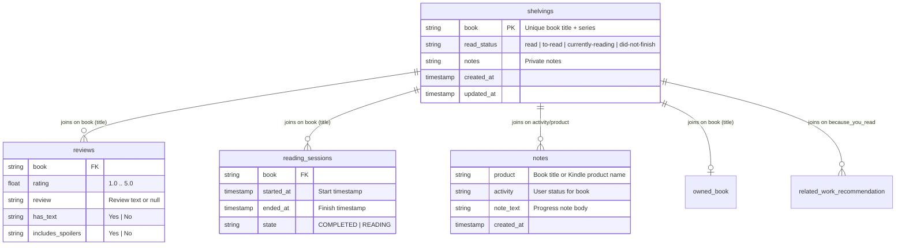
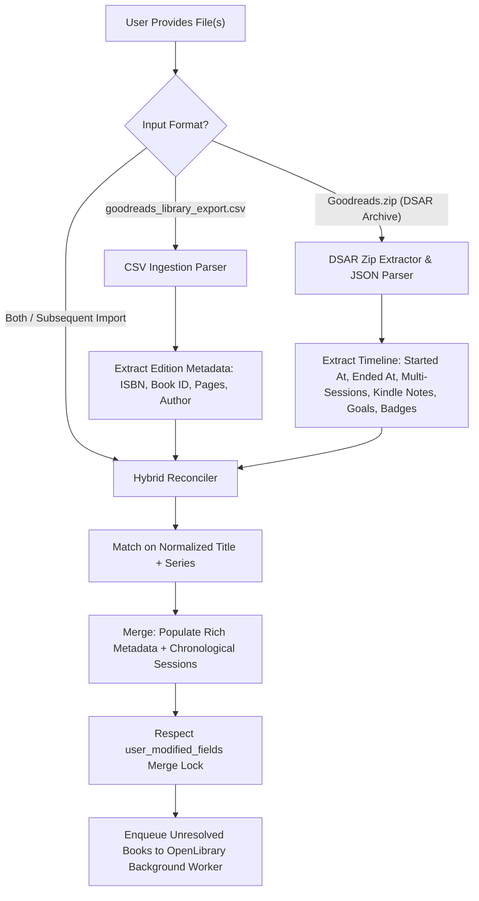
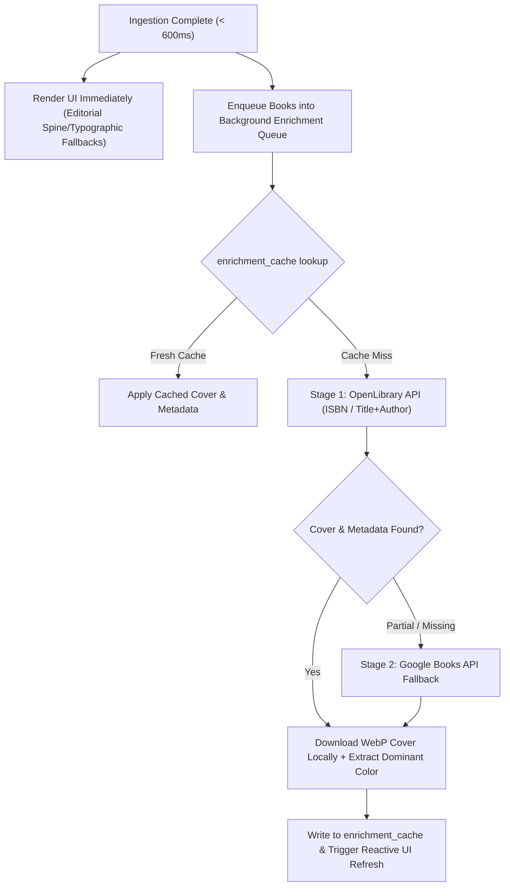

# v0 Data Pipeline, Goodreads Ingestion & Canonical Schema

## 1. Overview & Architectural Goals

The data pipeline is designed around four foundational principles:
1. **Dual Ingestion Engine (Legacy CSV + DSAR JSON Archive)**: Deterministically parse and ingest both export modalities provided by Goodreads:
   - **Legacy Library Export (`goodreads_library_export.csv`)**: Quick, single-file export containing rich edition metadata (Goodreads Book ID, ISBN/ISBN13, Author, Publisher, Page Count, Average Rating) but limited to a single read date per book and missing reading sessions, quotes, and Kindle notes.
   - **GDPR / DSAR Export (`Goodreads.zip`)**: Comprehensive, nested multi-directory JSON export containing full chronological reading sessions (start and end dates, multi-read logs), Kindle progress notes, reading goals, challenge achievements, liked quotes, author followings, and algorithmic recommendations.
2. **Lossless & Quirks-Aware Normalization**: Handle all known format quirks deterministically:
   - Excel formula strings (`="0140283293"`, `="9780140283297"`).
   - DSAR explanation wrappers (`[ { "explanation": [...] }, ... ]`).
   - DSAR sentinel strings (`"(not provided)"` -> `NULL`, `"Yes"`/`"No"` -> `1`/`0`).
   - Dual timestamp formats (`"YYYY-MM-DD HH:MM:SS UTC"` and ISO-8601 `"YYYY-MM-DDTHH:MM:SSZ"`).
   - Rating conversions (`0` in CSV -> `NULL`; `1.0..5.0` floats in DSAR).
   - Title parentheticals with embedded series (`"Dune (Dune, #1)"`).
   - HTML entities and spoiler tags (`<spoiler>...</spoiler>`, ` `).
3. **Platform-Agnostic Canonical Storage**: Decouple internal models (`books`, `reading_sessions`, `shelves`, `annotations`, `reading_goals`, `reading_achievements`, `user_quotes`, `enrichment_cache`) so future importers (StoryGraph CSV, Hardcover, Kindle `My Clippings.txt`, Readwise) map cleanly into the same store.
4. **Non-Destructive Idempotent Merging & Hybrid Synergy**: When a user imports a CSV, a DSAR JSON archive, or both, the pipeline performs identity resolution across books, merges reading session histories, attaches Kindle notes and quotes, and preserves user manual edits via field-level merge protection (`user_modified_fields`).

---

## 2. Ingestion Modality 1: Legacy `goodreads_library_export.csv`

Goodreads provides a 24-column UTF-8 CSV via `goodreads.com/review/import`. Below is the complete field mapping:

| # | Column Header | Sample Raw Value | Sanitization Rule | Canonical Target |
|---|---|---|---|---|
| 1 | `Book Id` | `44767458` | Trim whitespace; store as string identifier | `books.goodreads_book_id` |
| 2 | `Title` | `"Dune (Dune Chronicles, #1)"` | Extract clean title + series name & position | `books.title`, `books.series_name`, `books.series_position` |
| 3 | `Author` | `"Frank Herbert"` | Normalize whitespace; store as primary author | `books.primary_author` |
| 4 | `Author l-f` | `"Herbert, Frank"` | Trim whitespace; sort key fallback | `books.author_sort_name` |
| 5 | `Additional Authors` | `"Brian Herbert, Kevin J. Anderson"` | Split by `, `, trim, serialize as JSON array | `books.additional_authors` (`JSON`) |
| 6 | `ISBN` | `="0441172717"` | Strip `="` and `"`; validate 10-char ISBN (`[0-9]{9}[0-9X]`); empty -> `NULL` | `books.isbn10` |
| 7 | `ISBN13` | `="9780441172719"` | Strip `="` and `"`; validate 13-digit numeric; empty -> `NULL` | `books.isbn13` |
| 8 | `My Rating` | `0` or `5` | Parse int: `0` -> `NULL` (unrated); `1..5` -> float `1.0..5.0` | `books.user_rating`, `reading_sessions.rating` |
| 9 | `Average Rating` | `4.26` | Parse float (`0.00` to `5.00`) | `books.community_rating` |
| 10 | `Publisher` | `"Ace Books"` | Trim whitespace; empty -> `NULL` | `books.publisher` |
| 11 | `Binding` | `"Paperback"` | Normalize to enum (`paperback`, `hardcover`, `ebook`, `audiobook`, `other`) | `books.format`, `books.binding_raw` |
| 12 | `Number of Pages` | `688` | Parse positive int; `0` or empty -> `NULL` (queued for enrichment) | `books.page_count` |
| 13 | `Year Published` | `2005` | Parse 4-digit integer year; invalid/empty -> `NULL` | `books.edition_publish_year` |
| 14 | `Original Publication Year` | `1965` | Parse signed integer year (supports BCE); fallback to `Year Published` | `books.original_publish_year` |
| 15 | `Date Read` | `2023/08/14` | Convert `YYYY/MM/DD` -> ISO-8601 `YYYY-MM-DD`; empty -> `NULL` | `reading_sessions.finished_at` |
| 16 | `Date Added` | `2022/11/03` | Convert `YYYY/MM/DD` -> ISO-8601 `YYYY-MM-DD` | `books.added_at` |
| 17 | `Bookshelves` | `"sci-fi, favorites, to-read"` | Split by `, `, deduplicate against `Exclusive Shelf`, map to `shelves` | `shelves.slug`, `book_shelves` |
| 18 | `Bookshelves with positions` | `"sci-fi (#4), to-read (#12)"` | Parse `([a-zA-Z0-9_-]+)\s*\(#(\d+)\)` for shelf position rank | `book_shelves.shelf_position` |
| 19 | `Exclusive Shelf` | `"read"` | Map to reading status (`read`, `currently-reading`, `to-read`, or custom like `dnf`) | `books.status`, `shelves.is_exclusive` |
| 20 | `My Review` | `"Masterpiece.  <i>Must read!</i>"` | Sanitize HTML (` ` -> `\n`, convert `<spoiler>` to markdown `\|\|...\|\|`) | `books.review_text`, `books.review_html` |
| 21 | `Spoiler` | `"true"` or `""` | Parse boolean (`"true"` / `"1"` -> `1`, else `0`) | `books.review_has_spoilers` |
| 22 | `Private Notes` | `"Borrowed from Alex"` | Decode HTML entities, convert ` ` to `\n` | `books.private_notes` |
| 23 | `Read Count` | `2` | Parse non-negative int (`0`, `1`, `2+`); reconciles session count | `books.read_count` |
| 24 | `Owned Copies` | `1` | Parse non-negative int | `books.owned_copies` |

---

## 3. Ingestion Modality 2: Goodreads DSAR Archive (`Goodreads.zip`)

Goodreads provides an automated Data Subject Access Request (DSAR) export via Amazon / Goodreads privacy settings. The export arrives as a nested zip archive containing individual subdirectories for each database table, each holding a `<name>.json` file.

### 3.1 Structural Packaging Patterns
The JSON files in the DSAR export exhibit three distinct structural archetypes:

1. **Archetype A: List with Explanation Header + Individual Records**
   - Pattern: `[ { "explanation": ["..."] }, record_1, record_2, ... ]`
   - Files: `shelvings.json`, `reading_sessions.json`, `user_quote.json`, `author_following.json`, `author_following_suggestion.json`, `owned_book.json`, `social_recommendations.json`, `related_work_recommendation.json`, `suggested_list.json`, `favorite_genres.json`, `user.json`.
2. **Archetype B: List with Explanation Header + Nested Sub-Tables**
   - Pattern: `[ { "explanation": ["..."] }, { "table_a": [...], "table_b": [...] } ]`
   - Files:
     - `reviews.json` -> contains `reviews` (87 records) and `review_drafts` (2 records).
     - `notes.json` -> contains `notes` (14 records).
     - `suggestions.json` -> contains `similarBooksCurRead`, `similarBooksWantToRead`, `similarBooks`.
     - `activity.json` -> contains `activities` (351 records) and `feeds` (16 records).
3. **Archetype C: Direct Lists without Explanation Header**
   - Pattern: `[ record_1, record_2, ... ]`
   - Files: `kindle_reading_insights_goal_information.json`, `kindle_book_rewards_achievements.json`.
4. **Archetype D: Line-Delimited JSON (NDJSON)**
   - Pattern: One JSON string per line.
   - Files: `kindle_logs.json`, `request_logs_archive_activity_y*.json`.

### 3.2 Inventory & Schema of Core Reading Files

Below is the verified schema and real record breakdown from user data:

#### 1. `shelvings/shelvings.json` (299 Records)
- **Explanation**: `"Your shelving of books."`
- **Fields**:
  - `book` (`string`): Full book title with series parenthetical, e.g. `"1984"`, `"The Handmaid’s Tale (The Handmaid's Tale, #1)"`.
  - `read_status` (`string`): Exclusive shelf status (`"read"`, `"to-read"`, `"currently-reading"`, `"did-not-finish"`).
  - `notes` (`string`): Private/shelf note, or `"(not provided)"`.
  - `comments_count` (`int`): Shelving comments count (e.g. `0`).
  - `likes_count` (`int`): Shelving likes count (e.g. `0`).
  - `last_comment_at` (`string`): Timestamp or `"(not provided)"`.
  - `last_revision_at` (`string`): `"YYYY-MM-DD HH:MM:SS UTC"`.
  - `created_at` (`string`): Shelved creation timestamp.
  - `updated_at` (`string`): Shelved update timestamp.
  - `user` (`string`): Display name (e.g. `"Murat"`).

#### 2. `reviews/reviews.json` (87 Reviews, 2 Drafts)
- **Explanation**: `"Your reviews and review drafts stored in the Goodreads."`
- **Sub-Table `reviews` Fields**:
  - `book` (`string`): Book title (100% matches `shelvings.book`).
  - `rating` (`float`): User rating (`1.0`, `2.0`, `3.0`, `4.0`, `5.0`).
  - `review` (`string`): Full review text (plain/HTML formatted) or `"(not provided)"`.
  - `has_text` (`string`): `"Yes"` or `"No"`.
  - `includes_spoilers` (`string`): `"Yes"` or `"No"`.
  - `recommend_for` (`string`): Recommendation note or `"(not provided)"`.
  - `review_text_language` (`string`): Language code (e.g. `"en"`, `"tr"`).
  - `rating_created_at`, `rating_updated_at`: Timestamps or `"(not provided)"`.
  - `review_text_created_at`, `review_text_updated_at`: Timestamps or `"(not provided)"`.
  - `created_at`, `updated_at`, `last_revision_at`: Standard UTC timestamps.
  - `user` (`string`): User display name.
- **Sub-Table `review_drafts` Fields**:
  - `book`, `review`, `user`, `created_at`, `updated_at`.

#### 3. `reading_sessions/reading_sessions.json` (144 Records)
- **Explanation**: `"Your read dates on Goodreads, including books you have started, finished, or are currently reading. Goodreads doesn't use reading sessions in customer facing languages. Read dates matches the help article: https://help.goodreads.com/s/article/000001769 on reading dates."`
- **Fields**:
  - `book` (`string`): Book title (100% matches `shelvings.book`).
  - `started_at` (`string`): Start date timestamp (`"2026-08-14 00:00:00 UTC"`) or `"(not provided)"`.
  - `ended_at` (`string`): Finish date timestamp (`"2026-08-21 00:00:00 UTC"`) or `"(not provided)"`.
  - `state` (`string`): `"COMPLETED"` or `"READING"`.
  - `created_at`, `updated_at`: Session audit timestamps.
  - `user` (`string`): User display name.
- **Re-read Capabilities**: Unlike legacy CSV (which only retains the single latest date), `reading_sessions.json` tracks multiple chronological read sessions per book (e.g. *No Longer Human* contains 3 distinct completed sessions; *The Hunger Games* contains 2).

#### 4. `notes/notes.json` (14 Records)
- **Explanation**: `"Notes you have made on your Kindle to Goodreads"`
- **Sub-Table `notes` Fields**:
  - `product` (`string`): Book title as recorded by Kindle (e.g. `"Anayurt Oteli"`, `"Dune Messiah (Dune Chronicles, #2)"`).
  - `activity` (`string`): Activity label, e.g. `"User status for book Dune Messiah (Dune, #2)"` (contains exact title matching `shelvings.book`).
  - `note_text` (`string`): The user's status commentary / reading progress note.
  - `note_activity_type` (`string`): e.g. `"ReadingProgressWithNote"`.
  - `posted_external_networks` (`list[string]`): e.g. `["goodreads"]`.
  - `is_deleted` (`string`): `"No"` or `"Yes"`.
  - `created_at` (`string`): Timestamp when note was posted.
  - `user` (`string`): User display name.

#### 5. `user_quote/user_quote.json` (16 Records)
- **Explanation**: `"Quotes you have liked"`
- **Fields**:
  - `quote` (`string`): Full quote text.
  - `origin` (`string`): Source attribution (e.g. `"Goodreads"` or book title).
  - `quote_position` (`int`): Display order position.
  - `liked` (`string`): `"Yes"` or `"No"`.
  - `note_text` (`string`): Optional user commentary or `"(not provided)"`.
  - `note_updated_at` (`string`): Timestamp or `"(not provided)"`.
  - `created_at`, `updated_at`: Timestamps.

#### 6. `favorite_genres/favorite_genres.json` (1 Record)
- **Explanation**: `"Genres you have marked as your favorite"`
- **Fields**:
  - `genres` (`string`): Comma-separated genre list (e.g. `"Classics,Comics,Contemporary,Crime,Ebooks,Fantasy,Fiction,Graphic novels,Historical fiction,History,Humor and Comedy,Mystery,Non-fiction,Philosophy,Science,Science fiction"`).
  - `additional_genres` (`string`): Comma-separated custom genres (e.g. `"linguistics,post-apocalyptic"`).
  - `genres_automatically_determined` (`string`): `"Yes"` or `"No"`.
  - `created_at`, `updated_at`: Timestamps.

#### 7. `author_following/author_following.json` (10 Records) & `author_following_suggestion` (5 Records)
- **Author Following**:
  - `author_followed` (`string`): Author name.
  - `created_at`, `updated_at`: Timestamps.
- **Author Following Suggestion**:
  - `author` (`string`): Suggested author name (e.g. `"Liu Cixin"`).
  - `status` (`string`): Status (e.g. `"Pending"`).

#### 8. `owned_book/owned_book.json` (1 Record)
- **Explanation**: `"Information on books you have marked that you own."`
- **Fields**: `book`, `comments_count`, `last_comment_at`, `created_at`, `updated_at`, `user`.

#### 9. Recommendations & Suggestions
- **`related_work_recommendation/related_work_recommendation.json` (69 Records)**:
  - `book` (`string`): Recommended title.
  - `because_you_read` (`list[string]`): List of trigger titles read by user.
  - `shelf` (`string`): Shelf tag context (e.g. `"did-not-finish"`, `"read"`).
  - `status` (`string`): e.g. `"marked for deletion"`.
- **`suggestions/suggestions.json` (3 Sub-Lists)**:
  - `similarBooksCurRead` (14 items), `similarBooksWantToRead` (25 items), `similarBooks` (25 items).
  - Record structure: `{"recommended_item": string, "source_book": string, "rank": int}`.
- **`social_recommendations/social_recommendations.json` (50 Records)**:
  - `book` (`string`), `latest_activity_at` (`string`).
- **`suggested_list/suggested_list.json` (7 Records)**:
  - `suggested_list_name` (`string`), `books_read_on_list`, `status` (`"unseen"`), `created_at`, `updated_at`.

#### 10. `kindle_reading_insights_goal_information.json` (6 Records) & `kindle_book_rewards_achievements.json` (12 Records)
- **Reading Goals**:
  - `goal_id` (`string`): e.g. `"TITLES_READ_YEAR_2026"`, `"TITLES_READ_YEAR_2025"`.
  - `goal_value` (`string`): Target books count (e.g. `"50"`, `"25"`, `"10"`).
  - `create_date`, `last_modified_date` (`string`): ISO-8601 timestamps (`"2026-01-01T15:52:00Z"`).
  - `has_been_congratulated` (`string`): `"false"` or `"true"`.
- **Achievements / Badges**:
  - `AchievementGroupName` (`string`): e.g. `"2026 Goodreads Winter Challenge"`.
  - `AchievementName` (`string`): e.g. `"BookBoss"`, `"SpeedReader"`, `"LastingReads"`.
  - `EarnDate` (`string`): ISO-8601 timestamp (`"2026-02-18T20:04:33Z"`).
  - `Marketplace` (`string`): `"Goodreads"`.
  - `Quantity` (`string`): e.g. `"1"`.

#### 11. `activity/activity.json` (351 Activities, 16 Feeds) & `user/user.json` (1 Record)
- **`activity.json`**:
  - `activities`: Progress updates, likes, book shelvings, and nested `reference_activity`.
  - `feeds`: Feed broadcast entries.
- **`user.json`**:
  - Account profile: `user_name`, `first_name`, `last_name`, `email`, `born_at`, `about_me`, `country`, `reviews_count`, `ratings` summary string (`"5-stars : 37 books, 4-stars : 23 books, ..."`), `currently_reading_title`.

---

## 4. Cross-File Join Keys & Relational Resolution

### 4.1 Join Verification & Match Rates
Audit against the user's dataset yields:
- **`shelvings` to `reviews`**: **100% exact match** (87 of 87 review books exist in `shelvings`).
- **`shelvings` to `reading_sessions`**: **100% exact match** (133 of 133 session books exist in `shelvings`).
- **`shelvings` to `notes`**: 7 of 8 books match directly on `notes.product`. The 8th book (`Dune Messiah (Dune Chronicles, #2)`) matches `shelvings.book` (`Dune Messiah (Dune, #2)`) via regex extraction on `notes.activity` (`User status for book (.*)`).
- **Shelving State History**: When a book has multiple shelving records in `shelvings.json` (e.g. *No Longer Human* shelved as `read` in 2024 and re-shelved as `to-read`), the latest record by `updated_at` determines current status while earlier records inform reading state transitions.

### 4.2 What DSAR JSON Has vs. What is Missing
| Data Element | Present in Legacy CSV? | Present in DSAR JSON? | Resolution Strategy in Pipeline |
|---|---|---|---|
| **Book Title & Series** | Yes (`Title`) | Yes (`book`) | Clean title & parse series via regex |
| **Goodreads Book ID** | Yes (`Book Id`) | No | Preserved from CSV; synthetic hash for DSAR |
| **ISBN10 / ISBN13** | Yes (`ISBN`, `ISBN13`) | No | Enriched via OpenLibrary / Google Books |
| **Primary Author** | Yes (`Author`) | No | Enriched via OpenLibrary Search API |
| **Page Count** | Yes (`Number of Pages`) | No | Enriched via OpenLibrary / Google Books |
| **Publisher & Binding** | Yes (`Publisher`, `Binding`) | No | Enriched via OpenLibrary |
| **Community Rating** | Yes (`Average Rating`) | No | Enriched or computed locally |
| **Start Date (`started_at`)** | **No** | **Yes** (`started_at`) | Ingested into `reading_sessions.started_at` |
| **Multiple Read Sessions** | **No** (Single latest date) | **Yes** (Full history) | Ingested into `reading_sessions` rows |
| **Kindle Progress Notes** | **No** | **Yes** (`notes.json`) | Ingested into `annotations` table |
| **Liked Quotes** | **No** | **Yes** (`user_quote.json`) | Ingested into `user_quotes` table |
| **Yearly Reading Goals** | **No** | **Yes** (`kindle_reading_insights`) | Ingested into `reading_goals` table |
| **Challenge Badges** | **No** | **Yes** (`kindle_book_rewards`) | Ingested into `reading_achievements` table |
| **Favorite Genres** | **No** | **Yes** (`favorite_genres.json`) | Ingested into `user_preferences` table |
| **Author Followings** | **No** | **Yes** (`author_following.json`) | Ingested into `author_followings` table |

---

## 5. Canonical Database Schema (SQLite / IndexedDB)

```mermaid
erDiagram
    books ||--o{ reading_sessions : "has logs"
    books ||--o{ book_shelves : "tagged on"
    shelves ||--o{ book_shelves : "contains"
    books ||--o{ annotations : "has highlights/notes"
    books ||--o| enrichment_cache : "enriched by"
    books ||--o{ book_recommendations : "has recommendations"
    users ||--o{ reading_goals : "tracks"
    users ||--o{ reading_achievements : "earns"
    users ||--o{ user_quotes : "curates"
    users ||--o{ author_followings : "follows"

    books {
        TEXT id PK "UUIDv7 or deterministic hash"
        TEXT goodreads_book_id UK "Nullable, indexed"
        TEXT isbn10 "Indexed"
        TEXT isbn13 "Indexed"
        TEXT openlibrary_work_id
        TEXT openlibrary_edition_id
        TEXT google_books_id
        TEXT title "Sanitized clean title"
        TEXT subtitle
        TEXT raw_title "Original imported title"
        TEXT series_name
        TEXT series_position
        TEXT primary_author "Main author display name"
        TEXT author_sort_name
        TEXT additional_authors "JSON array of strings"
        REAL user_rating "NULL or 0.5..5.0"
        REAL community_rating
        TEXT status "read | currently_reading | to_read | dnf | custom"
        TEXT publisher
        TEXT format "paperback | hardcover | ebook | audiobook | other"
        TEXT binding_raw
        INTEGER page_count
        INTEGER edition_publish_year
        INTEGER original_publish_year
        TEXT description "Enriched synopsis"
        TEXT subjects "JSON array of genres"
        TEXT cover_url_remote
        TEXT cover_path_local "Cached local asset path"
        TEXT cover_dominant_color "Hex color for UI glow"
        TEXT review_text "Clean plain/markdown review"
        TEXT review_html "Sanitized HTML review"
        INTEGER review_has_spoilers "0 or 1"
        TEXT private_notes
        INTEGER read_count "Default 0"
        INTEGER owned_copies "Default 0"
        TEXT added_at "ISO-8601 date"
        TEXT source_platform "goodreads_csv | goodreads_dsar | hybrid | manual"
        TEXT user_modified_fields "JSON array of locked columns"
        TEXT created_at
        TEXT updated_at
    }

    reading_sessions {
        TEXT id PK
        TEXT book_id FK
        INTEGER session_number "1, 2, 3..."
        TEXT status "read | currently_reading | dnf"
        TEXT started_at "ISO-8601 date (nullable)"
        TEXT finished_at "ISO-8601 date (nullable)"
        TEXT date_precision "day | month | year | unknown"
        REAL rating "Session-specific rating (nullable)"
        INTEGER pages_read
        TEXT source_platform "goodreads_csv | goodreads_dsar | manual"
        TEXT created_at
    }

    shelves {
        TEXT id PK
        TEXT slug UK "Normalized lowercase"
        TEXT name "Display name"
        INTEGER is_exclusive "0 or 1"
        INTEGER is_system "1 for standard shelves"
        TEXT color "UI badge color"
        INTEGER sort_order
    }

    book_shelves {
        TEXT book_id FK
        TEXT shelf_id FK
        INTEGER shelf_position
        TEXT added_at
    }

    annotations {
        TEXT id PK
        TEXT book_id FK
        TEXT type "kindle_note | highlight | review_quote"
        TEXT content "Passage or note body"
        TEXT activity_label "e.g. Reading Progress - page 200"
        INTEGER page_number "Nullable"
        TEXT created_at
        TEXT source_platform "goodreads_dsar | kindle_clippings | manual"
        TEXT external_hash UK
    }

    reading_goals {
        TEXT id PK
        INTEGER year "e.g. 2026"
        INTEGER target_books "e.g. 50"
        INTEGER completed_books
        TEXT source_platform "goodreads_kindle | manual"
        TEXT created_at
        TEXT updated_at
    }

    reading_achievements {
        TEXT id PK
        TEXT group_name "e.g. 2026 Goodreads Winter Challenge"
        TEXT achievement_name "e.g. BookBoss, SpeedReader"
        TEXT earned_at "ISO-8601 timestamp"
        TEXT marketplace "Goodreads"
        INTEGER quantity
    }

    user_quotes {
        TEXT id PK
        TEXT quote_text
        TEXT origin_author_or_book
        INTEGER position_rank
        INTEGER is_liked "1 or 0"
        TEXT user_note
        TEXT created_at
    }

    author_followings {
        TEXT id PK
        TEXT author_name
        TEXT status "following | suggested"
        TEXT created_at
    }

    book_recommendations {
        TEXT id PK
        TEXT recommended_book_title
        TEXT source_book_title "Book that triggered rec"
        TEXT recommendation_type "similar_currently_reading | similar_want_to_read | related_work | social"
        INTEGER rank_score
        TEXT created_at
    }

    enrichment_cache {
        TEXT lookup_key PK "isbn13:... | title_author:..."
        TEXT book_id FK
        TEXT provider "openlibrary | google_books | none"
        TEXT status "pending | success | partial | not_found | failed"
        INTEGER http_status
        TEXT payload_json
        INTEGER attempt_count
        TEXT last_attempted_at
        TEXT expires_at
    }
```

---

## 6. Hybrid Ingestion & Merging Strategy

When a user imports both `goodreads_library_export.csv` and `Goodreads.zip`:

### 6.1 Identity Resolution Waterfall
1. **Primary Match**: `goodreads_book_id` (when present in both or from previous CSV import).
2. **Secondary Match**: `isbn13` or `isbn10`.
3. **Tertiary Match**: Normalized clean title + series name (`lower(title) + lower(series_name)`).
4. **Fuzzy Fallback**: Normalized title string match using token-sort ratio (> 92% similarity) with identical `read_status`.

### 6.2 Data Merging Priorities
- **Title, Author, ISBN, Page Count**: Prefer CSV data (high precision edition info) over empty DSAR fields; if CSV missing, queue for OpenLibrary API enrichment.
- **Reading Sessions & Dates**: Prefer DSAR `reading_sessions.json` data over CSV `Date Read`. DSAR provides actual start dates (`started_at`), finish dates (`ended_at`), and multi-read history that CSV flattens.
- **Reviews & Ratings**: If rating exists in both, DSAR float (`1.0..5.0`) matches CSV integer (`1..5`); draft reviews from `reviews.json` are retained in `annotations`.
- **Kindle Notes & Quotes**: Directly populated from DSAR `notes.json` and `user_quote.json`.
- **User Edits**: Any field in `books.user_modified_fields` is never overwritten during merge.

---

## 7. Background Cover & Metadata Enrichment Pipeline

Goodreads exports (both CSV and DSAR) **do not include** book cover image files, subject/genre classifications, or synopses. To ensure a snappy, visually stunning experience without blocking import:

### 7.1 Provider Waterfall
1. **Stage 1: OpenLibrary API (Primary, Rate Limit: 2 req/s, Max 3 Concurrent)**
   - Lookup by ISBN: `GET https://openlibrary.org/api/books?bibkeys=ISBN:{isbn13},ISBN:{isbn10}&format=json&jscmd=data`
   - Covers: `https://covers.openlibrary.org/b/isbn/{isbn13}-L.jpg?default=false` (returns 404 on missing cover instead of 1x1 blank image).
   - Work Details: `GET https://openlibrary.org{work_key}.json` for synopsis and subjects.
   - Title + Author Search (for DSAR-only books without ISBN):
     - `GET https://openlibrary.org/search.json?title={clean_title}&author={author}&limit=1`
2. **Stage 2: Google Books API (Fallback, Rate Limit: 1 req/s with Exponential Backoff)**
   - Query: `GET https://www.googleapis.com/books/v1/volumes?q=isbn:{isbn13}` or `intitle:{clean_title}`.
   - High-Res Cover URL rewrite: Replace `zoom=1` with `zoom=2` and force `https://`.
3. **Stage 3: Offline Typographic Cover Generator**
   - If both providers return 404 or when offline, generate a deterministic SVG cover using book title, author, and an ambient hash-seeded palette.

---

## 8. Summary of Data Formats Supported

| Capability | Legacy `goodreads_library_export.csv` | GDPR DSAR `Goodreads.zip` | Antigravity Hybrid Engine |
|---|---|---|---|
| **Export Method** | Direct web download (`/review/import`) | Amazon Privacy DSAR Request | Accepts `.csv`, `.zip`, or unzipped folder |
| **Ingestion Format** | Single 24-column CSV | 40+ nested JSON & NDJSON files | Unified pipeline |
| **Book Identification** | Goodreads Book ID + ISBNs | Book title string with series | Multi-tier identity waterfall |
| **Reading Start Dates** | ❌ Not available | ✅ Available in `reading_sessions` | Preserved in `reading_sessions.started_at` |
| **Re-read History** | ❌ Only latest date | ✅ Full multi-session logs | Preserved as separate session rows |
| **Kindle Progress Notes** | ❌ Not available | ✅ 14+ timestamped notes | Mapped to `annotations` |
| **Liked Quotes** | ❌ Not available | ✅ 16+ quotes with order & notes | Mapped to `user_quotes` |
| **Yearly Reading Goals** | ❌ Not available | ✅ Goals across multiple years | Mapped to `reading_goals` |
| **Reading Badges** | ❌ Not available | ✅ Challenge achievements | Mapped to `reading_achievements` |
| **Recommendation Graph** | ❌ Not available | ✅ 150+ algorithmic/social recs | Mapped to `book_recommendations` |
| **Offline Covers & Synopses**| ❌ Not available | ❌ Not available | Enriched via OpenLibrary / Google Books |
