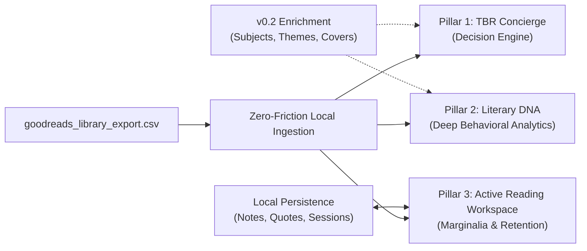

# v0 Product Strategy & Reading Experience Intelligence Notes

**Role:** Product Strategist & Reading Intelligence Designer (`reading-experience-strategist`)  
**Status:** v0 Blueprint  
**Primary Input Contract:** `goodreads_library_export.csv` + Local User Workspace State (IndexedDB / LocalStorage) + Optional OpenLibrary/Google Books Enrichment

---

## 1. Vision: From Static Spreadsheet to Active Reading Companion

### Why Goodreads Feels Like a Graveyard
For avid readers, Goodreads functions less like a studio for thought and more like a legacy accounting ledger:
1. **The TBR Black Hole:** The `to-read` shelf grows monotonically into hundreds of undifferentiated rows. When a reader finishes a book and asks *"What should I read next?"*, sorting by `Date Added` or `Average Rating` fails to capture context—how much free time they have this week, whether they want a brisk palate cleanser after an 800-page history, or why they added that obscure title four years ago.
2. **Vanity Counters Over Self-Knowledge:** Knowing you read 34 books in a year is a vanity metric. Readers rarely see their underlying **Literary DNA**: where their taste diverges sharply from crowd consensus, whether they systematically overrate long books (sunk-cost bias), which decades of human history dominate their attention, or how their reading velocity fluctuates by season.
3. **Ephemeral Reading & Amnesia:** Goodreads captures *when* a book started and *when* it ended, leaving the entire middle—the actual act of reading—blank. Six months after finishing a 5-star book, most readers struggle to recall key arguments, character arcs, or favorite passages because there is no frictionless workspace for active marginalia and structured post-read synthesis.

### The v0 Transformation
**v0** transforms a single, zero-friction upload of `goodreads_library_export.csv` into an immediate **Reading Intelligence Studio**:
- **Decision Engine over Static List:** Replaces endless scrolling on the `to-read` shelf with a context-aware **TBR Concierge** that prescribes the right book for the reader's current time budget, mood, and momentum.
- **Mirror for Taste:** Computes calibrated psychometric and behavioral reading indices directly from existing CSV columns (`My Rating`, `Average Rating`, `Number of Pages`, `Original Publication Year`, `Date Read`, `Date Added`, `Bookshelves`).
- **Living Marginalia Workspace:** Elevates `currently-reading` books into an active desk with pace projection, quote capture, character/concept scratchpads, and a low-friction 3-question exit reflection that compounds in value over years.

---

## 2. Core Pillar 1 — The TBR Concierge ("What Should I Read Next?")

Instead of displaying the `Exclusive Shelf == "to-read"` subset as a flat table, the TBR Concierge acts as an interactive sommelier that narrows hundreds of unread books down to a **curated Triad (3 distinct recommendations)** based on immediate constraints.

### 2.1 Page-Count Time Budgets & Reading Effort
Using `Number of Pages` combined with the reader's historical median reading pace (derived from `Date Added`/`Date Read` deltas or default 35 pages/day), every TBR book is bucketed into actionable time commitments:

| Time Budget Tier | Page Range | Typical Commitment | Best Used When... |
| :--- | :--- | :--- | :--- |
| **Single-Sitting / Flight** | `< 150p` | 2–4 hours | In transit, between heavy reads, or breaking a reading slump. |
| **Weekend Read** | `150p – 220p` | 1 weekend | Looking for a tight, high-completion-confidence narrative. |
| **Standard Feature** | `221p – 420p` | 1–2 weeks | Steady daily bedtime or commute reading habit. |
| **Deep Dive / Epic** | `500p+` | 3–5 weeks | High mental bandwidth, vacation, or immersive world-building craving. |

### 2.2 Mood & Pace Filters
Derived from user custom `Bookshelves` (e.g., `sci-fi`, `philosophy`, `thriller`, `non-fiction`), publication era, page length, and (in v0.2) enriched OpenLibrary subjects:
- **Palate Cleanser:** `< 240 pages`, high community `Average Rating (>= 4.00)`, published within the last 15 years.
- **High-Conviction Classic:** `Original Publication Year < 1975`, high global rating count or alignment with previously 5-starred eras.
- **Intellectual Stretch:** Non-fiction or dense literary works aligned with user's custom topical shelves.
- **Wildcard Spin:** A weighted random draw that intentionally surfaces high-potential outliers outside the user's recent 3-book streak.

### 2.3 The "TBR Dust" Score (Forgotten Gems vs. High-Momentum Picks)
Books on a TBR shelf decay in psychological urgency the longer they sit unread, even when the book itself is extraordinary. We quantify this explicitly:

$$\text{TBR Age (days)} = \text{Today} - \text{Date Added}$$

From this, we compute two complementary surfacing modes:
1. **Fresh Momentum Picks (`TBR Age < 90 days`):** Captures current curiosity while the reason for adding the book is still alive in working memory.
2. **Vintage Dust Gems (`TBR Age > 730 days` + Quality Signal):** Resurfaces forgotten treasures that have gathered 2+ years of digital dust but carry strong quality signals (`Average Rating >= 4.05` or written by an author the user has previously rated `>= 4★`).
   - *TBR Hygiene Action:* Includes a 1-click **"Still Curious / Archive from TBR"** triage mode for books with `TBR Age > 5 years`, helping users prune guilt-inducing clutter.

### 2.4 "Because You Loved [5-Star Book]" Affinity Matching
Even before external API enrichment, v0 computes an explainable **Affinity Score (0–100)** linking every `to-read` book to specific `5★` books on the user's `read` shelf:
- **Direct Author Lineage (+45 pts):** Unread book is by an author (or `Additional Authors` / translator) whom the user previously rated `4★` or `5★`.
- **Shelf/Cluster Overlap (+25 pts):** Jaccard similarity across the user's custom `Bookshelves` tags between the candidate TBR book and the user's `5★` library.
- **Structural Twin (+15 pts):** Matches the publication decade (`Original Publication Year`) and length bucket (`±20%` of `Number of Pages`) of a beloved `5★` cluster.
- **Crowd-Calibrated Floor (+15 pts):** Adjusts `Average Rating` by the user's personal Contrarian profile (e.g., if the user loves polarizing literary fiction with `3.6–3.8` average ratings, it doesn't penalize those candidates).

> **Explainable UI Card Copy Example:**  
> *"Recommended for your **Weekend Read (198p)** • **Because you gave 5★ to Jorge Luis Borges**: Shares your `speculative-short` shelf, 1960s publication era, and has waited **1,140 days** on your TBR shelf."*

---

## 3. Core Pillar 2 — Literary DNA & Deep Analytics

Moving past rudimentary bar charts of books per year, Literary DNA acts as an analytical mirror that reveals *how* the user reads and judges literature.

### 3.1 The Contrarian Index (`My Rating - Average Rating`)
For every rated book (`My Rating > 0`), we compute the **Rating Delta**:

$$\Delta_i = \text{My Rating}_i - \text{Average Rating}_i$$

Aggregating $\Delta_i$ across the `read` library yields four flagship insights:
1. **Overall Contrarian Score:** Mean absolute deviation $\frac{1}{N}\sum |\Delta_i|$ and signed bias $\frac{1}{N}\sum \Delta_i$ (whether the user is a **"Generous Enthusiast"** ($+\Delta$) or **"Tough Critic"** ($-\Delta$) compared to the Goodreads crowd).
2. ** Sacred Cows Slain ($\Delta_i \le -1.25$):** Books the community adores (`Average Rating >= 4.15`) that the user rated `1★–3★`.
3. **Hidden Champions ($\Delta_i \ge +1.00$):** Polarizing or under-the-radar books (`Average Rating <= 3.75`) that the user championed with `4★` or `5★`.
4. **Sunk-Cost vs. Brevity Bias:** Correlation between `Number of Pages` and $\text{My Rating}$—answering whether the user systematically rewards 600+ page tomes or prefers tight 200-page works.

### 3.2 Author Loyalty & Completion Score
Tracks depth vs. breadth across `Author l-f`:
- **Exploration Ratio:** Unique authors read divided by total books read ($U_{\text{authors}} / N_{\text{read}}$). Distinguishes **"Literary Nomads"** (90%+ unique authors) from **"Complete-the-Oeuvre Loyalists"**.
- **Author Loyalty Leaderboard:** Ranks authors by a composite of books read (`>= 2`), mean `My Rating`, reread frequency (`Read Count > 1`), and **TBR Backlog Completion Rate**:

$$\text{Author Completion \%} = \frac{\text{Read Books by Author}}{\text{Read Books by Author} + \text{TBR Books by Author}} \times 100$$

- Highlights **"Unfinished Obsessions"**: Authors where the user has rated 2+ books at `>= 4.5★` and still has unread titles waiting on the `to-read` shelf.

### 3.3 Publication Era Timeline (Classic vs. Contemporary Balance)
Uses `Original Publication Year` (falling back to `Year Published` only when missing, flagging edition skew when the gap exceeds 5 years) to map the reader's temporal footprint:
- **Era Distribution Histogram:** Antiquity/Pre-1800, 19th Century, Early 20th (1900–1949), Post-War (1950–1989), Turn of Millennium (1990–2009), and Contemporary (2010–Present).
- **The "Recency Bias" Gauge:** Percentage of read books published within 5 years of `Date Read` vs. "Backlist Deep Dives" (>25 years old at time of reading).
- **Golden Decade Identification:** Identifies the specific decade (e.g., *1920s* or *1970s*) where the user's mean `My Rating` peaks (minimum 4 books read).

### 3.4 Page Velocity & Seasonal Reading Rhythm
Derived from `Date Read`, `Date Added`, and `Number of Pages`:
- **Annual & Monthly Page Volume:** Tracks total pages read alongside book count—solving the distortion where a reader who tackled three 900-page biographies in a winter feels like they "read less" than a month with five 160-page novellas.
- **Seasonal Reading Heatmap:** Aggregates completions by month and quarter across all years to reveal personal rhythms (e.g., *"Summer Sprint in July/August"* vs. *"November Slump"*).
- **Time-to-Read Lag Distribution:** For books where `Date Added` precedes `Date Read`, measures how quickly acquired books are actually read:
  - *Impulse Reads:* Finished within 30 days of `Date Added`.
  - *Marinated Reads:* Finished 1–5+ years after `Date Added`.

---

## 4. Core Pillar 3 — Active Reading & Marginalia Workspace

When a book sits on the `currently-reading` shelf (or is promoted there from the TBR Concierge), v0 gives it a dedicated **Active Reading Desk** persisted locally and merged cleanly with CSV exports (`My Review`, `Private Notes`, `Read Count`).

### 4.1 Currently-Reading Dashboard & Finish-Date Projection
- **Dual-Mode Progress Tracker:** Update current position via exact page (`142 / 380p`) or percentage (`37%`) with a single slider or keyboard shortcut.
- **Live Pace & Finish-Date Estimator:**
  - Calculates rolling reading velocity (pages/day over the last 7 days or since start date).
  - Displays dynamic projection: *"At **28 pages/day**, you'll finish on **Thursday, Nov 14** (8 days left)."*
  - **"Target Finish Date" Reverse Calculator:** Lets the user pick a deadline (e.g., book club meeting or library return date) and computes the required daily quota: *"Read **34 pages/day** to finish by Sunday."*

### 4.2 Quote Vault, Chapter Thoughts & Scratchpad
To prevent great books from evaporating from memory, each active or completed book includes three structured, zero-clutter capture zones:
1. **Quote Vault:** Fast entry for memorable passages with `Page #` / `Location`, optional 1-word theme tag (e.g., `#mortality`, `#prose`, `#strategy`), and a toggle to mark as a **"Headline Quote"** for the book's summary card.
2. **Chapter / Session Stream:** Chronological micro-log attached to page markers (e.g., *"p. 112 — Unreliable narrator clue dropped here"*). Supports spoiler-safe collapsing.
3. **Character & Concept Scratchpad:** A pinned reference card for complex novels (Russian literature, sprawling sci-fi, histories) or dense non-fiction frameworks—mapping names, allegiances, or core mental models right next to the progress tracker so the reader never risks Googling spoilers.

### 4.3 The 3-Question Post-Book Reflection Prompt
When transitioning a book from `currently-reading` to `read`, v0 replaces the intimidating blank "Write a Review" box with a 90-second structured **Exit Interview**:
1. **The Core Distillation:** *"In 1–2 sentences, what was this book really about (or how did it make you feel)?"*
2. **The Lasting Artifact:** *"What is one idea, scene, or shift in perspective you want to remember 5 years from now?"*
3. **The Reader Handoff:** *"Who specifically would you hand this book to, and under what mood/circumstance?"* (This answer also feeds back into the user's personal recommendation memory).

> **Data Portability Guarantee:** All marginalia, quotes, and 3-question reflections can be exported anytime as clean **Markdown files (Obsidian/Notion-ready)** or serialized back into Goodreads-compatible `My Review` / `Private Notes` fields.

---

## 5. Phased Roadmap & v0 Scope Discipline

To deliver immediate magic from a single file drag-and-drop while building toward a comprehensive reading workspace, development follows three disciplined stages:

| Phase | Theme | Data Inputs | Key Deliverables |
| :--- | :--- | :--- | :--- |
| **`v0.1` (MVP)** | **Zero-Friction CSV Explorer & TBR Concierge** | `goodreads_library_export.csv` (100% client-side, instant load) | • Instant parsing of shelves, ratings, dates, and page counts. • **TBR Concierge:** Time-budget buckets (`<220p`, `500p+`), TBR Dust Score, and author/shelf/era affinity matching to `5★` favorites. • **Literary DNA Core:** Contrarian Index (`My Rating - Average Rating`), Author Loyalty & Completion Score, Publication Era Timeline (`Original Publication Year`), and Page/Seasonal Rhythm. |
| **`v0.2`** | **Enrichment & Active Reading Companion** | `v0.1` + Local Workspace Storage + OpenLibrary / Google Books API | • **Background Cover & Metadata Enrichment:** High-res book covers, granular subject/genre taxonomy, and mood tags. • **Active Reading Desk:** `currently-reading` page/percentage tracker, live finish-date projection, Quote Vault, Character/Concept Scratchpad, and 3-Question Post-Book Reflection. • **Markdown / JSON Export** for personal knowledge bases (Obsidian, Logseq, Notion). |
| **`v0.3`** | **Multi-Platform & AI Synthesis / Book Club** | `v0.2` + StoryGraph / Hardcover / Kindle Clippings (`My Clippings.txt`) + Optional LLM Synthesis | • **Multi-Source Importers:** Merge Kindle highlights (`My Clippings.txt`), StoryGraph CSVs, and Goodreads exports into one unified library. • **Semantic Cross-Book Synthesis:** Connect quotes and concepts across multiple books read years apart. • **"Compare Literary DNA" Mode:** Shareable, privacy-first Taste Cards and side-by-side Contrarian/Overlap comparisons for book clubs or reading partners. |
