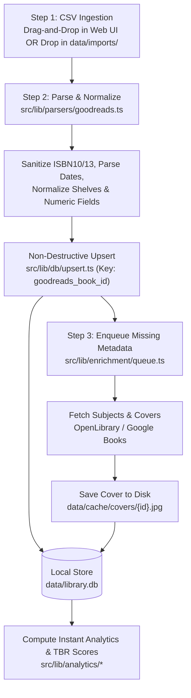

# 04 — v0 Technical Architecture & Local Stack Notes

**Author:** `fullstack-builder` (Local-First Web App & API Engineer)  
**Target Environment:** Windows Localhost (`localhost:3000` / `localhost:5173`), Zero Cloud Dependencies  
**Status:** v0 Architecture Specification

---

## 1. Recommended Local-First Tech Stack for v0

To guarantee an effortless, zero-config startup on Windows (`npm install && npm run dev`) without requiring Docker, external database servers, cloud accounts, or native C++ build-tool headaches where avoidable, we evaluate two local-first architectures and select our primary stack with a built-in pure-JS fallback.

### Stack Option Comparison

| Layer | Option A: Next.js (App Router) + SQLite *(Recommended Primary)* | Option B: Vite + React + Express/Hono + Structured JSON / IndexedDB *(Zero-Native Fallback)* |
| :--- | :--- | :--- |
| **Runtime & Framework** | **Next.js 14/15 (Node.js runtime)** with React 18/19 & TypeScript | **Vite + React + TypeScript** frontend paired with a lightweight local Node API (`Hono` or `Express`) |
| **Styling & UI** | **Tailwind CSS** + **Radix UI / Lucide Icons** + **Framer Motion** | **Tailwind CSS** + **Radix UI / Lucide Icons** + **Framer Motion** |
| **Primary Persistence** | **SQLite** via `better-sqlite3` (or Node's native `node:sqlite` in Node 22.5+) stored in `data/library.db` | **Structured Local JSON Store** (`data/library.json` with atomic write-ahead temp files) + browser **IndexedDB** cache |
| **File System Access** | Built-in via Next.js Route Handlers (`app/api/*`) reading/writing `data/` directly | Local Node server middleware reading/writing `data/` or browser File System Access API |
| **Windows Ergonomics** | Prebuilt binaries for `better-sqlite3` work out of the box on standard Node LTS; ACID transactions and fast SQL aggregations | 100% pure JavaScript—immune to `node-gyp` or Visual Studio C++ Build Tools issues on locked-down Windows machines |

### Selected v0 Stack Specification

1. **Application Framework**: **Next.js (App Router, TypeScript)** running locally on Node.js.
   - Provides both rich interactive client views and local Node.js API route handlers (`src/app/api/...`) in a single process and single `npm run dev` command.
   - Enables direct filesystem watching on `data/imports/` and local cover caching in `data/cache/covers/`.
2. **Storage Engine (Dual-Adapter Local Store)**:
   - **Primary Engine**: **SQLite (`data/library.db`)** via `better-sqlite3` (or `sql.js` WASM / native `node:sqlite` as zero-native-dependency fallback).
   - **Human-Readable Snapshot**: Automatic JSON export/mirror (`data/library.snapshot.json`) so user data is always inspectable, git-friendly if desired, and portable.
3. **CSV Parsing**: **PapaParse** (`papaparse`) configured for RFC 4180 compliance, UTF-8 handling, and Goodreads-specific quirks (`="0140283293"` ISBN Excel-escaping, inconsistent date formats, HTML entities in reviews).
4. **Styling & Data Visualization**:
   - **Tailwind CSS** with custom warm editorial design tokens (parchment dark/light themes, serif headings, monospace telemetry).
   - **Recharts** or **Visx** for reading pace, publication-year histograms, and rating calibration charts.

---

## 2. Proposed Directory Structure

The codebase enforces strict separation between **parsers** (ingestion), **enrichment** (external metadata & cover caching), **analytics** (pure domain computation & recommendation scoring), **storage** (local persistence), and **UI views**.

```text
goodreads-local/
├── data/                                 # Local persistent data directory (git-ignored except .gitkeep)
│   ├── imports/                          # Drop-zone for goodreads_library_export.csv files
│   ├── cache/
│   │   └── covers/                       # Locally cached book cover images (<goodreads_id>.jpg)
│   ├── library.db                        # Primary local SQLite database
│   └── library.snapshot.json             # Optional JSON backup/mirror of books + user annotations
├── docs/
│   └── v0/                               # Architecture, data dictionary, analytics & UX specs
├── src/
│   ├── app/                              # Next.js App Router (Pages & Local API Routes)
│   │   ├── api/
│   │   │   ├── import/route.ts           # POST drag-and-drop CSV or trigger data/imports/ scan
│   │   │   ├── books/route.ts            # GET library catalog, PATCH local notes/tags/ratings
│   │   │   ├── enrich/route.ts           # POST/GET background enrichment queue status & worker trigger
│   │   │   └── covers/[id]/route.ts      # Serves locally cached cover from data/cache/covers/
│   │   ├── library/page.tsx              # Interactive Shelf, Filterable Grid & Book Detail Drawer
│   │   ├── analytics/page.tsx            # Reading Life Telemetry, Pace, & Calibration Charts
│   │   ├── recommendations/page.tsx      # Explainable Next-Read Engine & TBR Prioritizer
│   │   ├── layout.tsx                    # App shell, local sync status bar, drop-zone provider
│   │   └── page.tsx                      # Editorial Home Dashboard & Quick Drop-Zone
│   ├── components/
│   │   ├── import/                       # Drag-and-drop CSV overlay, import diff summary modal
│   │   ├── library/                      # BookCard, ShelfFilterBar, BookDetailDrawer, NoteEditor
│   │   ├── analytics/                    # YearlyVelocityChart, RatingDifferentialPlot, GenreBreakdown
│   │   ├── recommendations/              # RecommendationCard, WhyThisBookBadge, MoodSelector
│   │   └── ui/                           # Shared primitives (buttons, badges, drawers, skeletons)
│   ├── lib/
│   │   ├── db/
│   │   │   ├── index.ts                  # Storage adapter interface (SQLite + JSON fallback)
│   │   │   ├── schema.sql                # Tables: books, user_annotations, import_runs, enrichment_queue
│   │   │   └── upsert.ts                 # Non-destructive merge logic keyed by goodreads_book_id
│   │   ├── parsers/
│   │   │   ├── goodreads.ts              # Goodreads CSV parser, ISBN sanitizer, shelf & date normalizer
│   │   │   └── types.ts                  # RawGoodreadsRow & NormalizedBookRecord interfaces
│   │   ├── enrichment/
│   │   │   ├── openlibrary.ts            # OpenLibrary Covers & Work/Subjects API client
│   │   │   ├── googlebooks.ts            # Fallback metadata & thumbnail fetcher
│   │   │   └── queue.ts                  # Rate-limited background worker & local disk cover cacher
│   │   └── analytics/
│   │       ├── overview.ts               # Totals, page velocity, yearly/monthly aggregations
│   │       ├── taste-profile.ts          # Author affinity, rating differential (My Rating vs Avg Rating)
│   │       └── recommender.ts            # Deterministic scoring engine for TBR & discovery
│   └── types/
│       └── domain.ts                     # Shared TypeScript domain models across client & server
├── tests/
│   ├── parsers/goodreads.test.ts         # Unit tests for edge-case CSV rows & ISBN cleaning
│   ├── db/upsert.test.ts                 # Idempotent re-import & annotation preservation tests
│   └── analytics/recommender.test.ts     # Scoring determinism & cold-start tests
├── package.json
├── tsconfig.json
└── tailwind.config.ts
```

---

## 3. Data Flow & Sync Lifecycle

The system is designed around **non-destructive, idempotent re-imports**: a user can export a fresh `goodreads_library_export.csv` at any time and import it without losing custom notes, quotes, mood tags, or cached covers created inside the local app.



### Step 1: CSV Detection & Ingestion
- **Web UI Drag-and-Drop**: The user drags `goodreads_library_export.csv` anywhere onto the application window. The file is sent to `POST /api/import`.
- **Auto-Detected Local Folder (`data/imports/`)**: On startup (and via an on-demand "Scan `data/imports/`" button), the server checks `data/imports/` for any `.csv` file newer than the last recorded `import_runs.file_hash` (SHA-256) and ingests it automatically.

### Step 2: Instant Parse, Sanitization & Non-Destructive Upsert
1. **Sanitization (`src/lib/parsers/goodreads.ts`)**:
   - Strips Excel wrapper syntax from `ISBN` and `ISBN13` (e.g., `="9780140283297"` $\rightarrow$ `"9780140283297"`).
   - Normalizes `Date Read` and `Date Added` (`YYYY/MM/DD` or `YYYY-MM-DD`) into ISO-8601 strings.
   - Splits `Bookshelves` and `Bookshelves with positions` into structured arrays while keeping `Exclusive Shelf` (`read`, `currently-reading`, `to-read`, or custom exclusive shelves) canonical.
   - Converts `My Rating = 0` to `null` (`unrated`) so unrated books never skew rating averages.
2. **Idempotent Upsert (`src/lib/db/upsert.ts`)**:
   - Keyed uniquely by `goodreads_book_id` (`Book Id` column in CSV).
   - **Separated Schema Concern**:
     - `books` table stores Goodreads-sourced fields (`title`, `author`, `isbn13`, `my_rating`, `average_rating`, `num_pages`, `year_published`, `original_publication_year`, `date_read`, `date_added`, `exclusive_shelf`, `bookshelves_json`, `goodreads_review`).
     - `user_annotations` table (1:1 on `goodreads_book_id`) stores local-only additions (`custom_notes`, `favorite_quotes_json`, `mood_tags_json`, `pacing_tag`, `tbr_priority`, `manual_overrides_json`).
   - When re-importing a newer CSV, `books` columns update cleanly and an import diff summary (`+X new books, Y shelf transitions, Z updated ratings`) is returned to the UI, while `user_annotations` and `enrichment_data` remain untouched.

### Step 3: Background Enrichment & Local Cover Caching
1. **Queue Population**: After upsert, any book lacking a local cover (`cover_cached_at IS NULL`) or subject classification (`subjects_json IS NULL`) is added to the local `enrichment_queue`.
2. **Polite Background Worker (`src/lib/enrichment/openlibrary.ts`)**:
   - Processes queue items asynchronously with concurrency throttling (e.g., 2 requests/sec) so the UI remains 100% responsive immediately after CSV import.
   - Queries OpenLibrary Works/Editions API by `ISBN13` $\rightarrow$ `ISBN10` $\rightarrow$ `Title + Author` fallback, with Google Books API as secondary fallback.
   - Downloads cover thumbnails directly to `data/cache/covers/<goodreads_book_id>.jpg` and stores subject/genre tags in `books.subjects_json`.
   - Once cached on disk, the app serves covers offline via `/api/covers/[id]` with zero external network calls on future loads.

---

## 4. Verification & Testing Strategy (Partnered with `qa-verifier`)

To ensure high reliability across messy real-world Goodreads exports and Windows environments, verification is split into four automated and manual gates coordinated with `qa-verifier`:

### 1. Parser & Edge-Case Unit Suite (`tests/parsers/goodreads.test.ts`)
- **Excel Formula Unwrapping**: Verify `="0441172717"` and `=""` parse to `"0441172717"` and `null`.
- **Zero-Rating Semantics**: Confirm `My Rating = 0` is stored as `null` (`unrated`) and excluded from user rating averages.
- **Malformed & Missing Fields**: Verify books with missing `Number of Pages`, missing `Original Publication Year`, negative/invalid years, or multi-line HTML reviews with embedded commas and quotes parse without dropping rows.
- **Duplicate & Re-read Handling**: Validate behavior when `Read Count > 1` or when multiple editions exist.

### 2. Storage & Non-Destructive Merge Tests (`tests/db/upsert.test.ts`)
- **Idempotency Check**: Importing the exact same CSV twice produces `0` duplicate rows and identical analytics output.
- **Local Annotation Survival**:
  1. Import CSV v1 (100 books).
  2. Attach custom `mood_tags`, `custom_notes`, and a cached cover path to `goodreads_book_id = 12345`.
  3. Import CSV v2 where book `12345` moves from `to-read` to `read` with `My Rating = 5`.
  4. Assert that shelf and rating updated while `mood_tags`, `custom_notes`, and cover cache remain intact.

### 3. Analytics & Recommendation Determinism (`tests/analytics/`)
- Cross-check computed metrics (total books read, page totals, `My Rating - Average Rating` differential, publication-era buckets) against reference fixtures defined with `data-analyst`.
- Verify graceful degradation when optional fields (`Number of Pages`, `Date Read`, external OpenLibrary subjects) are absent.

### 4. Windows Localhost Smoke Test
- Verify clean startup from a fresh clone on Windows PowerShell (`npm install && npm run build && npm run start`).
- Confirm automatic creation of `data/imports/` and `data/cache/covers/` directories if missing, and verify offline startup when internet access is disabled.
